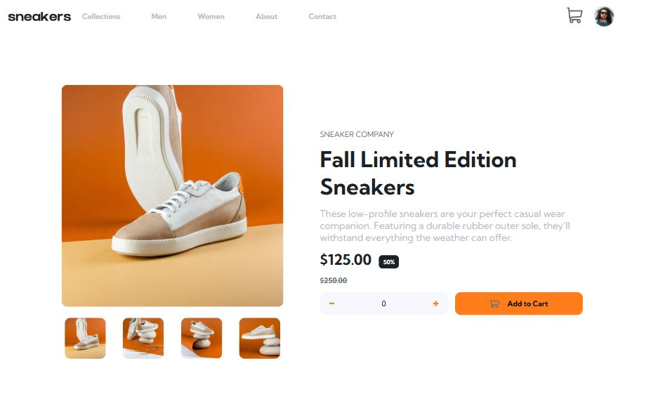

# Frontend Mentor - E-commerce product page solution

This is a solution to the [E-commerce product page challenge on Frontend Mentor](https://www.frontendmentor.io/challenges/ecommerce-product-page-UP_Z9MJFJ). Frontend Mentor challenges help you improve your coding skills by building realistic projects.

## Overview

### Screenshot

 <!-- Asegúrate de cambiar la ruta si tu captura tiene otro nombre -->

### Links

- **Solution URL:** [GitHub Repository](https://github.com/eduardoseq17/EcommerceProduct) <!-- Actualiza con tu link real si difiere -->
- **Live Site URL:** [Live Site](https://eduardoseq17.github.io/EcommerceProduct/) <!-- Actualiza con tu link real si difiere -->

## Built with

- Semantic HTML5 markup (`<header>`, `<nav>`, `<main>`, `<section>`, `<article>`)
- CSS Custom Properties (Variables)
- Mobile-first workflow & Responsive Design (Media Queries)
- Flexbox & CSS Grid for flexible component and layout structuring
- Vanilla JavaScript (ES6+) for interactive state management, dynamic cart logic, and synchronized image galleries
- Web Accessibility (a11y) best practices (`aria-label`, `aria-expanded`, semantic buttons)

## What I learned

While building this e-commerce product page, I focused on solidifying component state management in vanilla JavaScript, applying the DRY (Don't Repeat Yourself) principle, and creating a robust, synchronized interactive user experience:

- **State-Driven Cart Logic:** Implemented dynamic cart functionality handling item quantities, total price calculations (with currency formatting), empty/active cart states, and real-time badge updates (`cart-counter`).
- **Synchronized Gallery & Lightbox Architecture:** Designed a unified image-switching system using a shared state index (`currentImageIndex`) and modular functions (`imgChange`, `nextImg`, `previousImg`). This ensures that navigating through arrows or thumbnails simultaneously updates both the standard view and the modal lightbox without duplicating logic, fully respecting the **DRY principle**.
- **Event Delegation & Thumbnail Handling:** Utilized event delegation combined with `.closest()` and `querySelectorAll` to cleanly manage thumbnail clicks across multiple container elements for both the main gallery and the lightbox.
- **Modern CSS Selectors:** Leveraged advanced CSS capabilities like the `:has()` pseudo-class to control the conditional rendering of internal component states (such as switching the checkout button and cart content layout) directly from style rules.
- **Accessible UI Components:** Ensured buttons and toggles include proper ARIA attributes and screen-reader labels for improved accessibility across interactive components (cart dropdown, mobile menu, and modal overlays).

## Continued development

In future projects, I want to keep focusing on:

- Expanding cart functionality to support multiple unique products, quantities, and persistent storage using `localStorage`.
- Refining advanced keyboard accessibility (such as trap focus inside modals and dropdowns).
- Transitioning towards modular JavaScript architectures (ES Modules).

## AI Collaboration

I collaborated with Gemini as an interactive coding partner to troubleshoot scope selection with event delegation, structure a clean DRY pattern for synchronizing the lightbox and standard image galleries, and resolve CSS state management logic.

## Author

- GitHub - [@eduardoseq17](https://github.com/eduardoseq17)
- Frontend Mentor - [@eduardoseq17](https://github.com/eduardoseq17)
